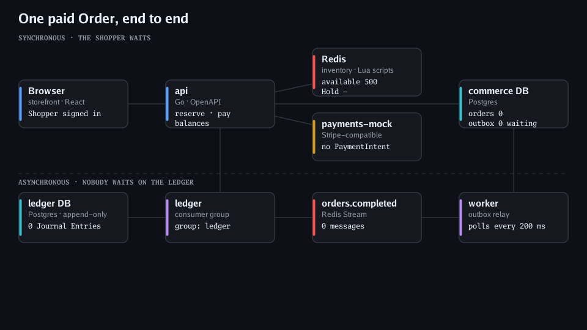
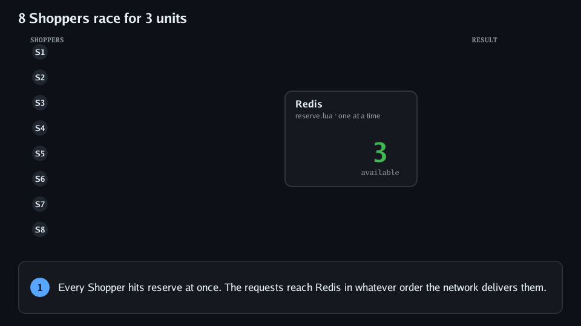
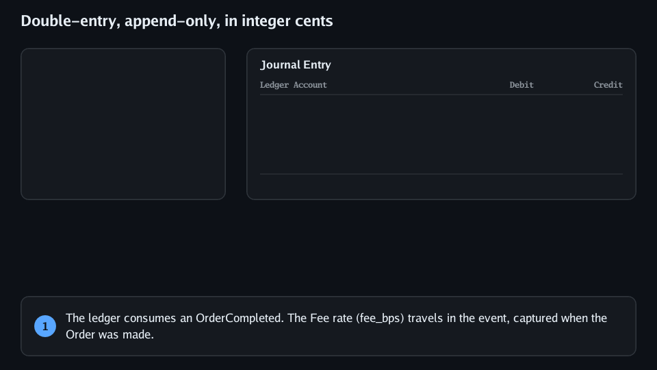
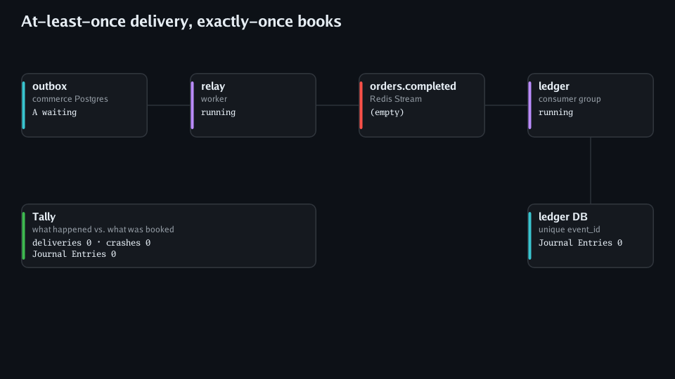

# Avalanche

A multi-store flash-sale platform built to show **resilience and idempotency under pressure**. Stores run Flash Sales of one product; Shoppers race to place a Hold on a unit, pay for it, and get an Order. Every Order is booked into a double-entry ledger that splits the money between the Store and the Platform's Fee.

A proof of concept in Go, Redis and Postgres. Each claim below is backed by tests against real Redis and Postgres.



## What it shows

### Many Shoppers, few units, no overselling

Redis owns a Flash Sale's inventory while it is LIVE. Reserve is one Lua script, and Redis runs one script at a time, so checking stock and taking a unit can never interleave. A Shopper gets at most one Hold per Flash Sale.



### The Order is written before the Hold is sold

Pay moves the Hold `HELD → PAYING`, charges through the real `stripe-go` SDK against a Stripe-compatible mock (`Idempotency-Key = hold_id`), then writes the Order **and** its `OrderCompleted` outbox row in one transaction. Only after that does the Hold become `SOLD` ([ADR-0006](docs/adr/0006-order-written-before-hold-is-sold.md)).

### Books that balance to the cent

The ledger is double-entry and append-only, in integer cents. The Fee is rounded half up and the Store gets the remainder. Postgres refuses any Journal Entry whose Postings don't sum to zero, and any UPDATE or DELETE ([ADR-0004](docs/adr/0004-double-entry-append-only-ledger.md)).



### At-least-once delivery, exactly-once books

Ledger writes are events, not calls: outbox → relay (`FOR UPDATE SKIP LOCKED`) → Redis Stream `orders.completed` → the ledger's consumer group ([ADR-0003](docs/adr/0003-ledger-writes-are-events.md)). Duplicates and crashes are expected. Each Journal Entry stores its event's unique `event_id` in the same transaction as its Postings, `XACK` happens only after the commit, and stale pending messages are reclaimed with `XAUTOCLAIM`.



## Architecture

| Service | Role |
|---|---|
| `cmd/api` | Browser-facing API: sign-in stub, Flash Sale listing, reserve, pay, balances. Contract in [`api/openapi.yaml`](api/openapi.yaml), generating the Go server and the TypeScript client. |
| `cmd/worker` | Moves Flash Sales `SCHEDULED → LIVE → ENDED` on schedule; relays the outbox to `orders.completed`. |
| `cmd/ledger` | Books `OrderCompleted` as Journal Entries; serves balances over internal REST, called only by `api`. |
| `cmd/payments-mock` | Stripe-compatible subset (PaymentIntents, idempotency keys), so switching to Stripe test mode is a config change. |
| `web/` | Storefront (Vite, React, TypeScript). |

Infrastructure runs in docker-compose: Redis (AOF `everysec`), and Postgres 18 with separate `commerce` and `ledger` databases.

Vocabulary is defined in [`GLOSSARY.md`](GLOSSARY.md), and decisions with their reasons are in [`docs/adr/`](docs/adr/).

## Run it

Needs Go 1.26, Docker, [Task](https://taskfile.dev), and Node with pnpm (via `corepack enable`).

```sh
task dev                 # infrastructure + api, worker, ledger and the web app (http://localhost:5173)
task seed -- -ago 26m    # demo Stores and Flash Sales, one of them LIVE now
```

```sh
task test                # unit and integration tests (start their own Redis/Postgres containers)
task test:e2e            # end-to-end, against the running stack
task typecheck
```

## Status

Built: the Flash Sale list, Flash Sales going LIVE and ENDED on schedule, reserve, pay, and Order → Journal Entry → Store balance. On the way, tracked in [issues](https://github.com/matthosch/avalanche/issues): Hold expiry, the 100k-request flood test with an invariant checker, checkout idempotency keys, hostile payment webhooks, provider timeouts, a ledger outage drill, telemetry and SLOs, live dashboards, and a chaos runner that injects each fault and prints a pass/fail table.
